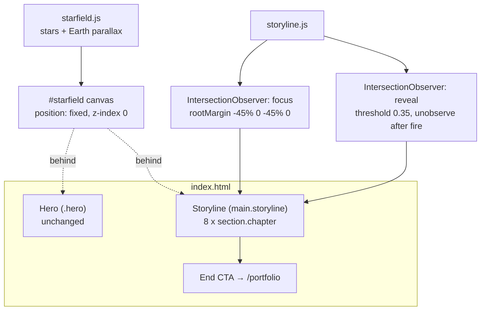

# Design Document — Career Storyline

## Overview

A scrolling career storyline is added to the homepage directly below the Earth hero. As the visitor scrolls, the Earth drifts up and off-screen through its existing `scrollY * 0.6` parallax in `starfield.js`, while the fixed starfield canvas stays behind everything. Eight chapters follow, newest to oldest, each pairing a short narrative with hand-built visuals (inline SVG charts and diagrams, locally stored logos and photos).

Key design choices:

- **Static-first markup.** Every chapter, chart, and diagram is written directly in `index.html` in its *final* state. JavaScript only adds behavior (focus color, play-once animation, org-chart interaction, counters). With JS off, or with reduced motion, the page shows everything finished (Req 4.3, 4.4).
- **One observer, no scroll handlers.** All scroll-driven behavior uses `IntersectionObserver`, so the storyline adds no per-frame work to compete with the Earth's 60ms recompute loop (Req 16.2–16.3).
- **Color lives only on media.** Logos and photos carry a CSS filter that drops to `none` when their chapter is focused. Charts, diagrams, and UI stay monochrome per DESIGN.md (Req 3).
- **Illustrative data is labeled.** Sandbox and Ballard charts use invented intermediate values, each marked "Illustrative" in mono text (Req 7.6, 8.4).

Section title proposal: **"Flight Log"** as the eyebrow over the storyline, which fits the SpaceX/telemetry voice of DESIGN.md. Chapter counters read `01 / 08` in Overpass Mono. The final chapter's eyebrow reads "Where it started" (Req 12.3).

## Architecture

### File layout

```
public/
├── index.html                      # + <main class="storyline"> with 8 chapters (static markup)
├── assets/
│   ├── css/
│   │   ├── main.css                # unchanged except removing dead .scroll-hint rules
│   │   └── storyline.css           # NEW: all storyline styles, loaded only on index.html
│   ├── js/
│   │   ├── starfield.js            # unchanged
│   │   ├── nav.js                  # unchanged
│   │   └── storyline.js            # NEW: focus, play-once, org chart, counters, image fallback
│   └── img/
│       ├── storyline/              # NEW: logos, photos, medallion, badge, website screenshot
│       └── storyline-attribution.txt  # NEW: source + license per asset
tests/
├── storyline.helpers.test.mjs      # NEW: node --test unit tests for pure helpers
└── storyline.browser-check.js      # NEW: in-page assertions run via the browser pane
```

`storyline.css` is a separate file so `portfolio.html` and `essays.html` don't download storyline styles. No build step and no framework are introduced (Req 16.4).

### System boundaries



The storyline never touches `starfield.js` or the canvas. Its containers sit at `z-index: 2` (same as `.container`) above the canvas.

### Progressive enhancement

An inline script in `<head>` runs before first paint:

```html
<script>document.documentElement.classList.add('js');</script>
```

CSS for "pre-animation" states (hidden line path, counters at zero, grayscale-until-focus) is scoped under `html.js:not(.reduce-motion)`. That means:

| Condition | Result |
|---|---|
| JS off | No `.js` class → everything shows final state, media in full color |
| JS on, IntersectionObserver missing | `storyline.js` adds `.storyline-static` → final state |
| JS on, `prefers-reduced-motion: reduce` | `storyline.js` adds `.reduce-motion` → final state; focus color still applies, but with `transition: none` |
| JS on, normal | Full behavior |

Note: with JS off, media shows in full color all the time rather than grayscale. This keeps "no-JS" honest (nothing hidden) and still reads fine.

## Components and Interfaces

### 1. Storyline container

```html
<main class="storyline" aria-labelledby="storyline-title">
  <div class="container">
    <p class="eyebrow">Flight Log</p>
    <h2 id="storyline-title" class="storyline-title">The story so far</h2>
  </div>
  <!-- 8 x section.chapter -->
  <div class="container storyline-end">
    <a href="/portfolio" class="btn btn-ghost">Full portfolio <span aria-hidden="true">&rarr;</span></a>
  </div>
</main>
```

Heading order: hero `h1` → storyline `h2` → chapter `h3` → visual captions as `figcaption`, no headings (Req 15.3).

### 2. Chapter

```html
<section class="chapter" id="ch-innosight" data-chapter="2" aria-labelledby="ch-innosight-title">
  <div class="container chapter-grid">
    <div class="chapter-text">
      <p class="chapter-index">02 / 08</p>
      <p class="chapter-org">Innosight, Huron Consulting</p>
      <h3 id="ch-innosight-title" class="chapter-role">Management Consulting Summer Analyst</h3>
      <p class="chapter-date">Jun 2026 – Aug 2026</p>
      <ul class="chapter-points"> … ≤3 items from portfolio.html … </ul>
    </div>
    <div class="chapter-visuals">
      <figure class="viz viz--media"> … </figure>
      <figure class="viz viz--chart" data-reveal> … </figure>
    </div>
  </div>
</section>
```

**Layout (Req 14):**
- ≥ 1024px: `grid-template-columns: 5fr 7fr`, gap 48px. Visuals area is its own sub-grid (2 columns) so 2–4 visuals tile.
- 640–1023px: same two columns, `4fr 8fr`; visuals sub-grid collapses to 1 column.
- < 640px: single column, text above visuals, `.container` padding stays 24px (≥16px gutter).
- Chapter `min-height: 80vh`, content vertically centered, `padding: 96px 0` (4xl). This gives each chapter a clear focus window without forcing full-screen snap.
- All grid children get `min-width: 0` (the DESIGN.md flex/grid overflow lesson).

**Text treatment:** `.chapter-index` and `.chapter-date` in Overpass Mono, `--text-faint` / `--text-dim`. `.chapter-org` is a 600-weight uppercase tracked label. `.chapter-role` is Overpass 800 uppercase, `clamp(1.5rem, 3vw, 2rem)`.

**Panels:** each `.viz` is a glass panel (`--panel` fill, `--border`, `--radius-lg`). The fill is 4.5% white, so stars stay visible through it (Req 1.6). Text sits on `--panel-strong` only where contrast over a bright star could fall under AA; in practice the `#F4F5FA` / `#9AA0B4` text on `#030304` passes AA. `--text-faint` (`#5B6078`) is used only for non-essential labels at ≥ 0.75rem, uppercase-tracked, matching current usage.

### 3. Focus controller (Req 3)

```js
// storyline.js
var focusObserver = new IntersectionObserver(onFocusChange, {
  rootMargin: '-45% 0px -45% 0px',   // a 10%-tall band at viewport center
  threshold: 0
});
chapters.forEach(function (c) { focusObserver.observe(c); });
```

`onFocusChange` keeps a set of intersecting chapters and calls `pickFocused(intersectingIndexes, lastFocused)`, a pure helper that returns one index. Chapters are stacked and taller than the band, so usually only one intersects. During the brief overlap at a boundary it keeps the previous one (no flicker). Exactly one chapter has `.is-focused` at a time, or none (Req 3.5).

CSS:

```css
html.js .chapter .media-logo  { filter: brightness(0) invert(1) opacity(.85); }
html.js .chapter .media-photo { filter: grayscale(1) contrast(1.05); }
html.js .chapter.is-focused .media-logo,
html.js .chapter.is-focused .media-photo { filter: none; }
.media-logo, .media-photo { transition: filter 300ms ease-out; }
html.js .chapter:not(.is-focused) .media-logo,
html.js .chapter:not(.is-focused) .media-photo { transition-timing-function: ease-in; }
html.reduce-motion .media-logo, html.reduce-motion .media-photo { transition: none; }
```

Logos are recolored to white through `brightness(0) invert(1)`, which works for any single- or multi-color logo file without needing separate white variants. The function lists match on both sides, so the transition interpolates smoothly.

### 4. Reveal controller — play once (Req 4)

Every animated figure has `data-reveal` and a `data-anim` type. A second `IntersectionObserver` (`threshold: 0.35`) adds `.is-revealed` once, then calls `unobserve`. All animation is CSS transitions/keyframes keyed off `.is-revealed`, plus small JS for counters.

| `data-anim` | Pre-state (under `html.js:not(.reduce-motion)`) | On `.is-revealed` |
|---|---|---|
| `draw` (line chart, flow edges, routes, loop) | `stroke-dashoffset: 1` (paths use `pathLength="1"`, `stroke-dasharray: 1`) | → `0` over 1200ms ease-out |
| `bars` (attendance, Gantt, pipeline) | `transform: scaleX(0)` / `scaleY(0)` with `transform-box: fill-box` | → `scale(1)`, staggered 80ms with `--i` |
| `pop` (nodes, pins, milestones, dots) | `opacity: 0; transform: scale(.85)` | → visible, staggered via `--i` |
| `count` (funding, stats) | text set to formatted 0 by JS | JS tweens to `data-to` over 1200ms using `requestAnimationFrame`, then stops |
| `packet` (AI Foundry flow) | packet hidden | one `<circle>` travels the path once via CSS `offset-path`; falls back to static if unsupported |

Only `transform`, `opacity`, `stroke-dashoffset`, and `filter` are animated. No layout properties change, so no long tasks (Req 16.2).

### 5. Chapter visuals

All charts and diagrams are inline SVG with `role="img"` and an `aria-labelledby` that points to a visually hidden `<p class="sr-only">` text equivalent inside the `figure` (Req 15.2). Monochrome palette: strokes `--text` / `--text-dim` / `--border`, fills `--panel`.

#### 5.1 AI Foundry @ BYU (Req 5)
- **Partner moment** (`viz--media`): two logo slots side by side, `AI Foundry / BYU` ✕ `Claude`, separated by a thin mono "×". Caption: "BYU, first university in the Claude partner network."
- **Automation flow** (`data-anim="draw packet"`): 4 nodes, left→right on desktop and top→bottom under 640px. The two orientations are two inline `<svg>`s, one hidden per breakpoint:
  `Incoming request` → `Claude: classify + draft` → `System update` → `Human review`.
  Caption: "Customer automation for a national data center cooling provider (illustrative)." No client name (Req 5.3).

#### 5.2 Innosight (Req 6)
- **Logo** (`media-logo`) + **Clayton Christensen photo** (`media-photo`), caption: "Clayton M. Christensen, Innosight co-founder and author of *The Innovator's Dilemma*. Photo: World Economic Forum / Remy Steinegger, CC BY-SA 2.0."
- **Org chart mini-tool** (interactive, see §6).

#### 5.3 Sandbox Accelerator (Req 7)
- **Satisfaction line chart** (`draw`): x = 7 points Sep→Apr, y axis 65–85%. Endpoints labeled directly "70%" and "79%". Mono caption "Illustrative trend · avg. student satisfaction".
- **Contributing factors** as three small linked panels under the chart, each with a thin connector line up to the chart:
  1. **Tech news segment** — mock episode card: `TECH BRIEF · EP 07`, three generic headline bars, "biweekly · 300+ founders".
  2. **Student interviews** — 2–3 anonymous quote bubbles (illustrative, e.g. "More hands-on time with founders.") with "Cohort interviews → class changes".
  3. **Speaker wall** — 5×4 grid of monogram tiles (`pop`), figures "20+ guests · 50+ hours". Monograms are generic, not real names, unless Dallin supplies real ones.

#### 5.4 Ballard Center (Req 8)
- **Startup consulting visual**: a mini Business Model Canvas (9-block grid) with sticky-note rectangles, two blocks emphasized: *Value Proposition* and *Social Impact*. Caption: "Advising founders on business model and impact."
- **Funding counter** (`count`): `$0 → $50,000+` in large Overpass 900, label "awarded to mentored founders".
- **Attendance chart** (`bars`): 4 bars, illustrative: 2022: 140, 2023: 165, 2024: 190 (prior record, dashed outline), 2025: 298 (+57%, solid white). Mono caption "Illustrative · showcase attendance". 298 / 190 = 1.568, so it holds 57% (Req 8.4).

#### 5.5 Creamies (Req 9)
- **Website mockup**: browser frame (3 dots + mono URL bar) wrapping a screenshot of the Creamies site (`media-photo`, so it warms to color on focus). Placeholder if no screenshot.
- **Store finder concept** (`pop`): simplified Utah-county-style street grid with 6 pins and a search bar. Label "Proposed from 300+ customer complaints". Pins are illustrative and don't mark real addresses (Req 9.5).
- **Gantt chart** (`bars`): 5 rows labeled `Intern A–E`, 6 week columns, bars for Website, SEO, Content system, Research, Store finder.
- **AI content pipeline** (`bars`): two horizontal bars, "Before" full width and "After" at 20%, label "~80% less time per piece".

#### 5.6 BYU Mock Trial (Req 10)
- **Iterative design loop** (`draw`): circular 4-stage loop `Build case → Compete → Judge feedback → Refine`, arrowheads, a center label "Product obsession". **Callout bubble** attached to "Judge feedback": "Mock trial is feedback-driven: every round is scored and critiqued, and we've run hundreds of rounds."
- **Team photo** (`media-photo`), placeholder until provided.
- **Zero-to-program track** (`pop`): 4 milestones on a horizontal rail (vertical under 640px): `Approval` → `$40K+ funding` → `3-credit course · 18 students` → `Top 10% of 700+ teams`.

#### 5.7 Brazil mission (Req 11)
- **Map** (`draw` for routes, `pop` for pins): Brazil outline simplified from Natural Earth (public domain) to a single SVG path (~2–4KB). Goiânia pinned (16.68°S, 49.25°W) and labeled. 4–5 arced routes to other cities in the mission area, labeled "Transfer routes (illustrative)".
- **Photos**: 2-photo strip (`media-photo`), placeholders until provided.
- **Leadership structure** (`pop`): 1 node → 30 leader dots → 120 volunteer dots in concentric rings. Labels "30+ leaders trained weekly", "~120 volunteers". Note: "Weekly reports refocused on replicable innovations."
- **Portuguese line**: chapter pull quote *"Liderar é servir."* in Overpass 800, with the English translation "To lead is to serve." shown below in `--text-dim` (always visible, not hover-only, so touch and screen-reader users get it). Has `lang="pt-BR"`. Dallin can swap in his own line.

#### 5.8 Presidential Scholar (Req 12)
- Eyebrow "Where it started · 2021" instead of `08 / 08` org label.
- **Medallion** (`media-photo`), caption "U.S. Presidential Scholar · top 161 of the 2021 national graduating class".
- **Eagle Scout badge** (`media-photo`), caption "VFW Eagle Scout of the Year, Utah, 2021".
- Both images sit in circular frames as the one exception to the 12px radius rule. They're circles of actual round objects, not pill UI, which is consistent with DESIGN.md's intent. Flag this for approval.

### 6. Interactive org chart (Req 6.3–6.6)

A tiered SVG of placeholder roles:

```
                 Board of Trustees (17)
                          │
                   President & CEO
      ┌──────────┬────────┴────────┬──────────┐
     COO        CFO               CTO     Chief Research Officer
   ┌──┴──┐       │              ┌──┴──┐        │
 Ops A  Ops B  Finance       Lab 1  Lab 2   Programs
```

Plus 2 dashed "decision" edges (e.g. Board → CRO "approves research portfolio", CFO ↔ COO "joint budget sign-off") to show *decision architecture*, not just reporting lines.

- Each node is an SVG `<g class="org-node" tabindex="0" role="button" aria-pressed="false" data-id="cfo">` with a rect at least 44×44 CSS px at the rendered mobile size (the SVG has a `min-width` so it scrolls inside its own panel rather than shrinking nodes below 44px; that inner scroll is horizontal scroll *within the figure*, not the page, per Req 14.3).
- Edges: `<path class="org-edge" data-from="ceo" data-to="cfo" data-kind="reports|decides">`.
- Interaction: `pointerenter`/`focus` → preview highlight; `click`/`Enter`/`Space` → pin selection (toggle). Highlight adds `.is-active` to the node, `.is-linked` to connected edges and nodes, `.is-dimmed` to the rest. `Escape` clears it.
- A live region under the chart (`aria-live="polite"`) reads e.g. "CFO: reports to President & CEO; shares budget decisions with COO."
- Caption: "Recreation of a decision-architecture tool built for a 4,000+ person organization. Names are placeholders."
- Side effect to note: `starfield.js` spawns a shooting star on every page click, so clicking nodes will also launch a shooting star. That's harmless and arguably charming, so no change is planned.

### 7. Image fallback and placeholders (Req 13)

Each media slot is written like this:

```html
<figure class="viz viz--media">
  <div class="media-frame" data-placeholder="Mock trial team photo">
    
  </div>
  <figcaption>…</figcaption>
</figure>
```

- If the file is missing or fails, an `error` listener in `storyline.js` adds `.is-placeholder` to `.media-frame`. CSS then hides the `` and shows a dashed-border box with the `data-placeholder` text in mono uppercase (Req 13.2–13.3).
- Every slot ships with its `` already pointing at its predictable path (see Data Models), even when the file doesn't exist yet. A missing file falls back to the placeholder automatically. When Dallin adds a photo at that path, it simply appears, with **no markup change at all** (exceeds Req 13.4).
- With JS off, a missing image shows the browser's alt text in the frame. That's acceptable.

### 8. Asset sourcing plan (Req 13.1, 13.5)

All files are stored in `public/assets/img/storyline/`. Each one is recorded in `storyline-attribution.txt` (source URL, author, license or trademark note, and changes made).

| Asset | Planned source | License / basis | Fallback |
|---|---|---|---|
| Clayton Christensen photo | Wikimedia Commons, `Clayton_Christensen_World_Economic_Forum_2013.jpg` (WEF / Remy Steinegger) | CC BY-SA 2.0, attribution in caption + attribution file; cropping noted as a change | Placeholder |
| Innosight, Sandbox, Ballard Center, Creamies, BYU, AI Foundry logos | Official sites / brand pages | Trademarks used nominatively to identify employers, unmodified apart from monochrome filter | Text wordmark in Overpass 800 |
| Claude / Anthropic mark | Anthropic's public brand/press assets | Trademark, nominative use | Text wordmark |
| Presidential Scholars medallion | U.S. Department of Education / presidentialscholars program imagery | U.S. government work (public domain) if from ed.gov; verify per image | Placeholder |
| Eagle Scout badge | Wikimedia Commons Eagle Scout imagery | Per-file license (verify); BSA trademark, nominative use | Placeholder |
| Brazil outline | Natural Earth admin-0 | Public domain | — (hand-drawn simplified path) |
| Creamies website screenshot | Screenshot of the live site captured in the browser pane | Dallin's own work | Placeholder |
| Mock trial team photo, Brazil photos | Dallin | Own photos | Placeholder (ships this way) |

If a license can't be confirmed for a given file, its placeholder ships instead.

## Data Models

The site is static, so the "data model" is a markup contract plus a small set of constants.

### Chapter contract

| Field | Where | Example |
|---|---|---|
| `id` | `section#ch-{slug}` | `ch-sandbox` |
| index | `data-chapter` (1–8) + `.chapter-index` text | `3`, `03 / 08` |
| org, role, dates | `.chapter-org`, `h3.chapter-role`, `.chapter-date` | must match `portfolio.html` (Req 2.5) |
| points | `ul.chapter-points` (≤3 `li`) | copied from `portfolio.html` |
| visuals | `.chapter-visuals > figure.viz` | 2–4 per chapter |

Slugs, in order: `ai-foundry`, `innosight`, `sandbox`, `ballard`, `creamies`, `mock-trial`, `brazil`, `origin`.

### Asset naming

`/assets/img/storyline/{slug}-{asset}.{ext}`, for example `innosight-logo.svg`, `innosight-christensen.jpg`, `mock-trial-team.jpg`, `brazil-photo-1.jpg`, `brazil-photo-2.jpg`, `creamies-site.jpg`, `origin-medallion.png`, `origin-eagle.png`, `ai-foundry-logo.svg`, `ai-foundry-claude.svg`.

### Illustrative datasets (hard-coded into SVG)

```js
// Sandbox: avg student satisfaction (%), illustrative
[ ['Sep', 70], ['Oct', 71], ['Nov', 73], ['Jan', 74], ['Feb', 76], ['Mar', 78], ['Apr', 79] ]

// Ballard: showcase attendance, illustrative; 298 / 190 = +57%
[ ['2022', 140], ['2023', 165], ['2024', 190, 'prior record'], ['2025', 298, '+57%'] ]
```

Values are also kept as `data-` attributes on the SVG for the browser-check script.

### Org chart data

Defined once in `storyline.js` as `{ nodes: [{id, label}], edges: [{from, to, kind, note}] }`. It's used only to build the adjacency map and live-region text. Node positions stay in the static SVG, so the chart renders without JS.

### Pure helpers (unit-tested)

Exported for Node through `if (typeof module !== 'undefined') module.exports = …`:

- `pickFocused(intersecting: number[], last: number|null): number|null`
- `formatCount(value: number, template: string): string`, e.g. `('$', 50000, '+')` → `$50,000+`
- `tween(from, to, t): number` with ease-out cubic
- `linkedIds(graph, id): { nodes: string[], edges: string[] }`
- `describeNode(graph, id): string` (live-region text)
- `pctIncrease(a, b): number`, used by the test that guards the 57% Ballard ratio

## Error Handling

| Failure | Handling |
|---|---|
| Image 404 / decode error | `error` listener → `.is-placeholder` with labeled box (Req 13.2) |
| No `IntersectionObserver` | Add `.storyline-static`, so everything shows in final state, full color, no focus effect |
| JS disabled | No `.js` class, so final states show by default (Req 4.4) |
| Reduced motion (also live changes via `matchMedia` `change` event) | `.reduce-motion` → final states, focus color without transitions (Req 4.3) |
| CSS `offset-path` unsupported (packet animation) | `@supports not (offset-path: path('M0 0'))` hides the packet; edges still draw |
| Counter runs while tab hidden | `requestAnimationFrame` pauses naturally; tween is time-based, so it finishes correctly on return |
| Org chart pointer + keyboard conflict | Pinned selection wins over hover preview; `Escape` and clicking empty space clear |
| Narrow viewport with wide SVG (org chart) | Figure gets `overflow-x: auto` inside its panel; page body never overflows (Req 14.3) |
| Earth overlapping storyline | The Earth is offset by `scrollY * 0.6` and exits once `ey + r*1.2 < 0`. The storyline starts after the full-height hero, and the Earth's lower edge has cleared the first chapter by the time it's in focus. The browser check verifies there's no overlap at 1280×800 and 375×812 (Req 1.4) |

## Testing Strategy

The site has no build or test framework, so testing has two layers and adds nothing to the shipped site.

### 1. Unit tests: `node --test tests/` (no dependencies)

`storyline.js` keeps its pure helpers in a block that is also `require`-able. Tests cover:
- `pickFocused`: none, single, overlap keeps last, last scrolled out.
- `formatCount`: `$50,000+`, `0`, and rounding mid-tween.
- `tween`: endpoints exact, monotonic.
- `linkedIds` / `describeNode`: reporting vs decision edges, unknown id, and that every edge references existing nodes.
- Data guards: Ballard `pctIncrease(190, 298)` rounds to 57; Sandbox series starts at 70 and ends at 79.

These are written first (TDD) for each helper before the DOM wiring that uses it.

### 2. Browser checks: `tests/storyline.browser-check.js`

Run in the built-in browser pane against the local server (`.claude/launch.json` → `python3 -m http.server 8743`). The script returns a pass/fail report:
- 8 chapters in the required order, each with org/role/date, and text matching `portfolio.html` (fetched and compared).
- Every `img` has an `alt` attribute; every `svg[role=img]` has a non-empty text equivalent.
- Heading order h1 → h2 → h3 with no skips.
- No horizontal page overflow at widths 320, 375, 640, 768, 1024, 1280 (`document.documentElement.scrollWidth <= innerWidth`).
- Interactive targets ≥ 44×44 at 375px.
- Focus: scroll each chapter to center → exactly one `.is-focused`, and it's that chapter.
- Reveal: before scroll nothing is `.is-revealed`; after scroll it is, and stays after scrolling back.
- Org chart: Tab reaches nodes, Enter pins, linked classes are correct, Escape clears, live region text updates.
- Placeholders: temporarily point a slot at a missing path → `.is-placeholder` with label.
- Performance: `PerformanceObserver({entryTypes:['longtask']})` during a scripted scroll through all chapters → 0 tasks over 50ms (Req 16.2), same method as the Earth verification in DESIGN.md.
- Reduced motion: emulate it and reload → no element in a pre-animation state, and `transition-duration` on media is 0.
- Earth overlap: at the first chapter's focus point, the Earth's computed bottom edge is above the chapter's top.

### 3. Visual review

Screenshots at desktop and mobile widths for each chapter, compared against DESIGN.md: monochrome UI, Overpass/Overpass Mono, 4px buttons, 8–12px panels, no accent color except focused media.

### DESIGN.md updates (Req 16.5)

Add a "Career Storyline" section covering: media color-on-focus rule (the one sanctioned color besides the Earth), illustrative-data labeling, circular frames for medallion/badge, play-once animation rule, and the "no scroll handlers, IntersectionObserver only" performance rule.
